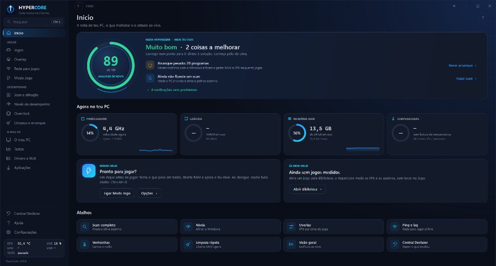

<div align="center">

# ⚡ HyperCore

**Cada núcleo no máximo.** _(antigo FrameForge)_

**O ecossistema completo para Windows de monitorização em tempo real, telemetria segura para jogos, diagnóstico de hardware, otimização de desempenho e gestão total de aplicações.**

[](https://github.com/FrameForge-Beta/FrameForge-Beta/releases/latest)
[](https://dotnet.microsoft.com/)
[](https://learn.microsoft.com/dotnet/csharp/)
[-00C853?style=for-the-badge&logo=shield&logoColor=white)](#-arquitetura-anti-cheat-segura)

<br/>



</div>

---

## 📖 Sobre o Projeto

O **HyperCore** (antigo FrameForge) é uma suite completa de diagnóstico, telemetria, afinação e manutenção para utilizadores exigentes e PC gaming no Windows. Desenvolvido em **C# / .NET 8 / WPF**, combina leitura de hardware de baixo nível, eventos do kernel (ETW) sem injeção em jogos, testes de periféricos e uma central completa de aplicações — tudo numa única interface escura moderna (azul elétrico & ciano) acelerada por GPU.

---

## ✨ Novidades e Funcionalidades Principais

### 1. 📦 Central de Aplicações Completa (Atualizar · Instalar · Desinstalar)
- **Atualizar aplicações (`winget`):**
  - Deteta automaticamente os programas instalados no PC que têm atualizações pendentes (com suporte opcional a versões desconhecidas `--include-unknown`).
  - Barra de pesquisa instantânea, seleção individual ou em lote com progresso em tempo real e paragem em 2 estágios (`PARAR` / `CANCELAR AGORA`).
  - **Nunca atualizar:** opção direta por aplicativo para bloquear permanentemente atualizações indesejadas, com painel integrado dentro da própria aba para consultar ou reativar a qualquer momento.
- **Instalar aplicações (Catálogo +16.500 apps):**
  - Integração personalizada com a API do **winstall.app** (com cache em memória e fallback local via `winget search`).
  - **12 categorias e coleções** (*Em Alta*, *Pacotes Prontos*, *Mais Populares*, *Navegadores*, *Jogos*, *Comunicação*, *Áudio & Vídeo*, *Desenvolvimento*, *Utilitários*, *Segurança & VPN*, *Produtividade* e *Inteligência IA*).
  - **Pacotes Prontos** (*Windows Essentials*, *Gaming Essentials*, *AI Essentials*, *Developer Essentials*, etc.) para adicionar coleções inteiras com 1 clique.
  - **Fila de instalação em lote persistente:** marque apps em diferentes categorias/pesquisas e instale tudo de uma só vez.
- **Desinstalar aplicações (estilo Revo Uninstaller):**
  - Lista programas Win32 (64/32-bit, `HKLM` e `HKCU`) e aplicativos da Microsoft Store (`Appx`).
  - **Limpeza de resíduos em modal centralizado:** após o desinstalador oficial terminar, o HyperCore volta para a frente e abre no centro da tela o assistente de resíduos (pastas em `AppData`/`ProgramData`/`Program Files`, atalhos e chaves de Registro órfãs) com seleção por item e espaço libertado.
  - **Forçar desinstalação (`FORÇAR` e `FORÇAR POR NOME`):** encerra processos em execução na pasta do app e remove arquivos e entradas de registro presas.
  - **Proteção contra remoção acidental:** componentes críticos/do sistema (drivers, Visual C++, .NET, WebView2, Store, etc.) recebem aviso em **vermelho** na lista e exigem confirmação num **modal de alerta centralizado na tela**.

### 2. 📊 Início, Nota HyperCore e Telemetria em Tempo Real
- **Nota HyperCore (0–100):** diagnóstico imediato do PC com recomendações acionáveis e atalhos diretos para cada correção.
- **Leitura Assíncrona de Sensores:** leitura de CPU, GPU, RAM, discos e temperaturas fora da UI thread (zero engasgos na interface e animações).
- **Mapa de Disco & Saúde S.M.A.R.T.:** análise visual de espaço em disco e estado de saúde de SSDs/HDDs.

### 3. 🎮 Biblioteca de Jogos, Modo Jogo e Overlay Sem Injeção
- **Biblioteca Unificada:** deteta jogos da Steam, Epic Games, Riot Games, GOG, Ubisoft, Battle.net, EA e executáveis manuais.
- **Gravação de Sessões (`Ctrl + Alt + R`):** métricas reais de **FPS Médio, 1% Low, 0.1% Low, frametimes e stutters/min** com relatórios em HTML/JSON.
- **Overlay Externo 100% Seguro:** janela transparente externa (sem hooks nem injeção de DLL), compatível com **Vanguard, Easy Anti-Cheat, BattlEye e VAC**.
- **Modo Jogo (1 clique):** liberta RAM, aplica o nível de otimização e plano de energia, e repõe tudo automaticamente ao sair.

### 4. 🖥️ Testes de Periféricos, Benchmarks e Stress Test
- **Periféricos (Rato, Teclado, Ecrã, Comando, Fones e Câmara):**
  - Teste de taxa de polling/duplo clique no rato, ghosting no teclado, medição real de Hz do monitor, píxeis mortos, teste de rasto/ghosting fluido (com `BitmapCache` e pausa automática de polling de GPU) e recuperador de píxeis presos (estilo JScreenFix).
- **Benchmarks & Stress Test:** testes de CPU, GPU (DX11/DX12/Ray Tracing), memória e disco, além de stress test com proteção térmica.

### 5. ⚡ Otimização, Rede, Ventoinhas, Drivers & RGB
- **Níveis de Desempenho & Central Desfazer:** ajustes graduais do Windows com registo completo no `ChangeJournal` para reverter qualquer alteração com 1 clique.
- **Rede para Jogos & DNS:** medição de ping, jitter, bufferbloat e benchmark direto de servidores DNS.
- **Drivers, Ventoinhas e RGB:** gestão de drivers (incluindo backup e drivers seriais offline CH340/CP210x/FTDI para Maker/Arduino), curvas de ventoinhas, overclock seguro com Crash Guard e controlo RGB (iCUE/OpenRGB/Razer).

---

## 🛠️ Tecnologias Utilizadas

| Componente | Tecnologia | Descrição |
|---|---|---|
| **Runtime & Linguagem** | **C# 12 · .NET 8.0 (Windows)** | Código assíncrono, otimizado e fortemente tipado. |
| **Interface Gráfica** | **WPF / XAML** | UI moderna escura/clara com renderização acelerada por GPU. |
| **Captura de Frames** | **ETW (`TraceEvent`)** | Captura de eventos `Present` do kernel (DXGI / D3D9) sem injeção. |
| **Gráficos & Benchmarks** | **DirectX 11 / 12 / DXGI (`Vortice.Windows`)** | Benchmarks nativos de GPU e medições de renderização. |
| **Sensores de Hardware** | **LibreHardwareMonitorLib & NVML** | Temperaturas, clocks, consumos e ventoinhas em background. |
| **Gestão de Aplicações** | **Windows Package Manager (`winget`) + API Winstall** | Atualizações, catálogo de +16.500 apps, instalação em lote e desinstalação estilo Revo. |
| **Empacotamento** | **NSIS (LZMA Solid)** | Instalador/atualizador único com deteção de versões anteriores e migração automática. |

---

## 📁 Estrutura do Projeto

```text
FrameForge-Beta/
├── Apps/          # Atualizador winget, API personalizada winstall.app e desinstalador estilo Revo
├── Benchmarks/    # Benchmarks de CPU, GPU (DX11/12/RT), RAM, disco e stress test
├── Core/          # Serviços globais, definições, ChangeJournal (Central Desfazer) e mapa de disco
├── Data/          # Índice de desempenho e referência de hardware
├── Docs/          # Guias auxiliares (ex.: empacotamento NSIS)
├── Drivers/       # Drivers seriais embutidos (CH340, CP210x, FTDI, Arduino)
├── Fans/          # Motor de curvas de ventoinhas
├── Games/         # Biblioteca de jogos, Modo Jogo e gravador de sessões
├── Hardware/      # Coleta de hardware, GPU, NVML/NVAPI, discos, bateria, USB e drivers
├── Net/           # Rede para jogos, bufferbloat, monitorização e benchmark de DNS
├── Optimize/      # Níveis de desempenho, configuração gamer, arranque e manutenção
├── Overclock/     # Afinação segura de GPU e Crash Guard
├── Overlay/       # Overlay externo sem injeção
├── Pages/         # Páginas modernas da aplicação e catálogo de navegação
├── Peripherals/   # Testes de rato, teclado, ecrã (Hz/rasto/JScreenFix), comando, áudio e câmara
├── RGB/           # Integrações de iluminação (Corsair iCUE, OpenRGB, Razer)
├── Sensors/       # Monitorização assíncrona de sensores e frames
├── Themes/        # Estilos globais (Theme.xaml, FfTheme.xaml, ThemeManager.cs)
├── Windows/       # MainWindow (XAML + code-behind parciais), OverlayWindow e ToastWindow
└── installer/     # Script NSIS (HyperCore_compile.nsi) e executável de instalação
```

---

## 🛡️ Arquitetura Anti-Cheat Segura

- ❌ **Sem Injeção de DLLs** no espaço de memória de nenhum jogo.
- ❌ **Sem Hooks de DirectX/Vulkan** dentro do processo do jogo.
- ❌ **Sem leitura invasiva** da memória de jogos.
- ✔️ **Event Tracing for Windows (ETW):** telemetria de frames fornecida pelos canais públicos do próprio Windows.

---

## 🚀 Como Instalar ou Compilar

### Opção 1: Instalador / Atualizador Oficial (Recomendado)
1. Acede às [Releases](https://github.com/FrameForge-Beta/FrameForge-Beta/releases/latest).
2. Transfere e executa **`HyperCore-Setup-0.5.5.exe`** como Administrador.
3. Se já tiveres uma versão anterior do HyperCore ou FrameForge instalada, o assistente fecha a versão antiga, atualiza automaticamente na mesma pasta e preserva as tuas definições em `%AppData%\HyperCore`.

### Opção 2: Compilar a partir do Código-Fonte
Requer [.NET 8.0 SDK](https://dotnet.microsoft.com/download/dotnet/8.0) no Windows:

```bash
git clone https://github.com/FrameForge-Beta/FrameForge-Beta.git
cd FrameForge-Beta
dotnet build HyperCore.csproj -c Release
dotnet run --project HyperCore.csproj -c Release
```

Para gerar o instalador NSIS (`installer/HyperCore_compile.nsi`):

```powershell
dotnet publish HyperCore.csproj -c Release -r win-x64 --no-self-contained -o publicar
& "C:\Program Files (x86)\NSIS\makensis.exe" "installer\HyperCore_compile.nsi"
```

---

## 📄 Licença

Este projeto está licenciado sob os termos da **Licença MIT**. Consulta o ficheiro [LICENSE](LICENSE) para mais detalhes.
